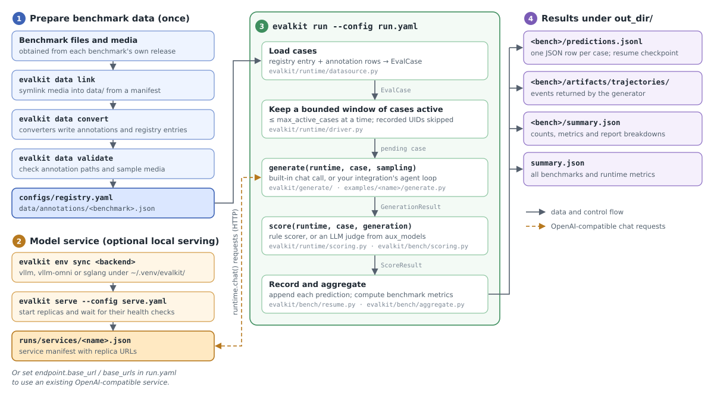

<div align="center">


# Video Agent EvalKit (VAE)

### Unified Evaluation Toolkit for Video Agents and Multimodal Models

<p>
  <a href="https://www.python.org/downloads/"></a>
  <a href="https://docs.astral.sh/uv/"></a>
  <a href="LICENSE"></a>
  <a href="https://github.com/Open-OmniCoach/omnicoach"></a>
  <a href="https://huggingface.co/Open-OmniCoach/Open-OmniAgent-30B-A3B"></a>
  <a href="https://huggingface.co/Open-OmniCoach/Open-OmniAgent-7B"></a>
</p>

</div>

> **Video Agent EvalKit (VAE)** evaluates video agents and multimodal models across benchmarks with text, image, video, and audio questions. Its `evalkit` runner calls models served over an OpenAI-compatible chat API, loads normalized benchmark cases, scores answers with each benchmark's own scorer, and writes per-case predictions, optional trajectories, and summary metrics—with automatic resume after interruptions.

The Python package and command remain `evalkit` for compatibility with existing configs and integrations. This is the **`omnicoach`** integration branch, which adds the trained [OmniCoach agent](examples/omni_agent/README.md) (`Open-OmniAgent-7B` and `Open-OmniAgent-30B-A3B`) on top of VAE's shared runner and template; see [`main`](https://github.com/Open-OmniCoach/video-agent-evalkit/tree/main) for the general-purpose core toolkit.

<p align="center">
  
</p>

## Key Capabilities

- **Normalized benchmarks & scorers**: Score a checkpoint, hosted API, or custom multi-turn agent across registered benchmarks with consistent normalized data and scorers.
- **Resumable bounded concurrency**: Run long evaluations across one or more replicas with bounded active cases and automatic resume from recorded predictions.
- **Trajectory artifact capture**: Save per-turn agent trajectories and optional raw model exchanges (`trajectory: trainable`) alongside predictions for downstream analysis or training.
- **Clear separation of concerns**: `evalkit` is an evaluation runner—it does not train models, download benchmark datasets, or host results. Model weights, benchmark annotations, and raw media stay outside the repository (only a 3-question text sample ships in `data/`).

## Requirements

| Requirement | Notes |
| --- | --- |
| Python 3.11 or newer | `.python-version` selects 3.12 for `uv`. |
| `uv == 0.11.28` | Every `pyproject.toml` sets `required-version = "==0.11.28"`; other `uv` versions refuse to sync. |
| Model endpoint | An existing OpenAI-compatible `/v1/chat/completions` service, or NVIDIA GPUs for a local vLLM, SGLang, or vLLM-Omni backend. |
| Benchmark files | Obtained from each benchmark's official release; see [docs/data.md](docs/data.md). Not required for the bundled sample. |

Install the pinned `uv` version:

```bash
curl -LsSf https://astral.sh/uv/0.11.28/install.sh | sh
# or, for an existing standalone uv installation:
uv self update 0.11.28
uv --version
```

## Installation

```bash
git clone https://github.com/Open-OmniCoach/video-agent-evalkit.git
cd video-agent-evalkit
git switch omnicoach
uv sync --locked
source .venv/bin/activate
```

`uv sync --locked` installs:

- the `evalkit` package and CLI, whose only runtime dependencies are `httpx` and `PyYAML`;
- the default `media` dependency group: `static-ffmpeg` (user-space FFmpeg/FFprobe), Pillow, and Decord (Decord wheels exist only for Linux `x86_64` and Windows `x86_64`; skip with `uv sync --locked --no-group media` when the model service reads media paths or URLs directly).

Two extras are optional: `convert` (`pandas`, `pyarrow`) for `evalkit data convert`, and `test` (`pytest`).

Integrations that process media on the evaluation host need FFmpeg and FFprobe (checked against `environments/tools.toml`):

```bash
evalkit env sync tools
```

Local serving backends use isolated locked environments under `environments/`. Install the backend selected by your serve config:

```bash
evalkit env sync vllm
# Other configurations select sglang or vllm-omni.
```

## Quick Start (Bundled Sample)

`configs/registry.yaml` registers `sample_mcq`, three text-only questions in [`data/sample_mcq.jsonl`](data/sample_mcq.jsonl). Create a run config pointing `model.endpoint` at an OpenAI-compatible service:

```yaml
registry_path: configs/registry.yaml
data_root: data

model:
  name: candidate
  generate_fn: evalkit.generate.openai_chat:generate
  endpoint:
    base_url: http://127.0.0.1:8000/v1
    model: my-model
    api_key_env: MODEL_API_KEY

out_dir: runs/sample
scheduler:
  max_active_cases: 32

eval_datasets:
  - name: sample_mcq
```

Run evaluation:

```bash
evalkit run --config my_run.yaml
```

### Output Structure & Resume

With `out_dir: runs/sample`:

```text
runs/sample/
  summary.json                  every benchmark's summary plus runtime metrics
  sample_mcq/
    predictions.jsonl           one JSON row per case; also the resume checkpoint
    summary.json                n_total, n_failed, n_unscored, wall_seconds, metrics
    artifacts/trajectories/     created only when a generator emits trajectory events
```

Each `predictions.jsonl` row records `uid`, `status`, raw `response`, parsed `prediction`, `score`, `score_details`, `error`, `facets`, `generation` (usage, timing, endpoint, and finish reason), and `trajectory_artifact`. Re-running the same config skips already recorded UIDs, including failed cases—use a new `out_dir` for a different model or configuration. See [docs/reporting.md](docs/reporting.md) for per-category breakdowns.

## Evaluating Real Benchmarks

Prepare benchmark annotations and media symlinks once per data root:

```bash
uv sync --locked --extra convert
evalkit data link --data-root data --manifest configs/media_links.example.yaml
evalkit data convert omnivideobench omnivideo_test_full jointavbench_full \
  video_mme_full video_mme_v2_full futureomni_full \
  lvomnibench timelens_bench worldsense \
  --data-root data --registry-path configs/registry.yaml --validate
evalkit data validate --data-root data --registry-path configs/registry.yaml
```

`data link` symlinks local media into `data/` from a manifest ([`configs/media_links.example.yaml`](configs/media_links.example.yaml)). Converters read original benchmark annotations into `data/annotations/<benchmark>.json` and update the registry. See [docs/data.md](docs/data.md) for expected source layouts, then list target benchmarks under `eval_datasets` in your run config.

## Model and Agent Examples

Run examples from the repository root with `evalkit run` (the wheel installs only `evalkit`, not top-level `examples/`). Model weights and benchmark data are supplied separately:

| Example | Purpose | Local Backend |
| --- | --- | --- |
| [Integration template](examples/_template/README.md) | Custom `generate` function and 3-question smoke config | Existing API or vLLM |
| [Qwen3-Omni Instruct](examples/qwen3_omni_instruct/README.md) | Single-turn Instruct baseline (native video or timestamped frames, 64K context) | vLLM |
| [OmniCoach / Qwen2.5-Omni](examples/omni_agent/configs/qwen2_5_omni/run.yaml) | Trained [`Open-OmniAgent-7B`](https://huggingface.co/Open-OmniCoach/Open-OmniAgent-7B) agent, 96 initial frames, 128K context | vLLM |
| [OmniCoach / Qwen3-Omni](examples/omni_agent/configs/qwen3_omni/run.yaml) | Trained [`Open-OmniAgent-30B-A3B`](https://huggingface.co/Open-OmniCoach/Open-OmniAgent-30B-A3B) agent, up to 256 initial frames, 64K context | SGLang |

`examples/qwen3_omni_instruct` owns its media protocols and `QWEN3_OMNI_MEDIA_CACHE_DIR` cache. The trained OmniCoach agents share `examples.omni_agent.generate:generate`, decoded media, and `OMNI_AGENT_*` environment variables; see the [OmniCoach setup guide](examples/omni_agent/README.md) for checkpoints, serving configs, and cache settings.

## Bring Your Own Model or Agent

By default `evalkit.generate.openai_chat:generate` sends each case once. For custom prompts, tool loops, multi-turn agents, or bespoke media preprocessing, point `model.generate_fn` at an async generator:

```yaml
model:
  generate_fn: my_package.my_agent.generate:generate
```

```python
async def generate(runtime, case, sampling) -> GenerationResult:
    ...
```

The generator owns prompts, tools, and the final response; scoring remains decoupled in the benchmark scorer. Read [docs/adding-a-model.md](docs/adding-a-model.md) for configuration, retries, and trajectory schemas.

## Documentation

| Topic | Guide |
| --- | --- |
| Add a model/agent, configure runs, record trajectories | [docs/adding-a-model.md](docs/adding-a-model.md) |
| Prepare benchmark data and the registry | [docs/data.md](docs/data.md) |
| Serve models, route across replicas, configure endpoints | [docs/serving.md](docs/serving.md) |
| Send video, audio, or extracted frames | [docs/multimodal.md](docs/multimodal.md) |
| Understand rule scoring and LLM judges | [docs/scoring.md](docs/scoring.md) |
| Break metrics down by category | [docs/reporting.md](docs/reporting.md) |
| Evaluate a subset without copying data | [docs/subsets.md](docs/subsets.md) |

## Repository Layout

```text
configs/registry.yaml          Global benchmark & data registry
data/                          Normalized annotations & linked raw media (sample_mcq included)
docs/                          Guides, reference docs & workflow assets
environments/                  Locked, isolated serving backend environments (vllm, sglang, vllm-omni)
evalkit/
  bench/                       Loaders, rule scoring, aggregation, resume
  runtime/                     Bounded scheduler, HTTP transport, routing, judge scoring
  generate/                    Built-in single-turn & reference agent generators
  serve/                       Local backend process supervisor
examples/
  _template/                   Starter integration with run & optional serve configs
  omni_agent/                  Trained OmniCoach agent, model configs & chat templates
  qwen3_omni_instruct/         Single-turn Instruct baseline & benchmark recipes
tests/                         Unit tests (also directly executable scripts)
```

`configs/` intentionally omits a global run config: runs are model/agent-specific while the benchmark registry is shared.

## Branches & Scope

- **[`main`](https://github.com/Open-OmniCoach/video-agent-evalkit/tree/main)**: Portable evaluation core, documentation, bundled `sample_mcq`, integration template, and Qwen3-Omni Instruct baseline.
- **`omnicoach`**: Extends `main` with trained Open-OmniCoach agents (`examples/omni_agent/`), model configs, chat templates, and agent unit tests.

Model checkpoints, benchmark annotations and media, credentials, service manifests, full prediction artifacts, and host-specific cluster profiles stay outside Git.

## Contributing

Report issues and propose changes at <https://github.com/Open-OmniCoach/video-agent-evalkit>. See [CONTRIBUTING.md](CONTRIBUTING.md) for development setup, test commands, and repository boundaries.

## License

Released under the [MIT License](LICENSE).
